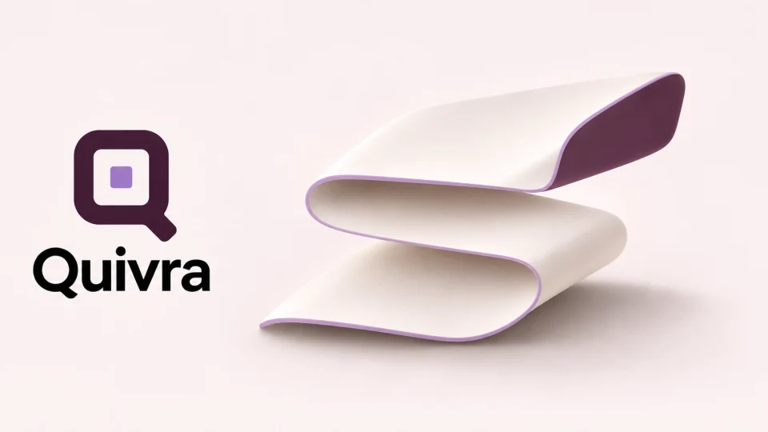

<p align="center">
  
</p>

# Quivra

**Generate TypeScript clients from OpenAPI with your project's templates.**

Quivra reads an OpenAPI document and prepares typed data for MiniJinja. Your profile controls the generated models, clients and file layout. Start with Fetch or bring your own HTTP transport.

[](https://github.com/pixel-brewery/quivra/actions/workflows/ci.yml)
[](LICENSE)

[Get started](#get-started) · [Compare profiles](#compare-profiles) · [Documentation](#documentation) · [Build from source](#build-from-source) · [Project website](https://pixel-brewery.github.io/quivra/) · [Product icon](.github/assets/quivra-icon.png)

## Why Quivra exists

Different projects need different clients for the same HTTP contract. A standalone Fetch client and an application that already owns authentication, error handling and transport can share the OpenAPI parser while keeping their own code structure.

Quivra keeps those choices in editable templates. Commit the profile with your application and use `--check` to detect when your API or templates have changed since you last generated the client.

## Get started

Download the native binary for macOS, Linux or Windows from [GitHub Releases](https://github.com/pixel-brewery/quivra/releases/latest). For Node projects, install `@pixel-brewery/quivra` from GitHub Packages as described in the [distribution guide](docs/distribution.md).

```sh
quivra init --preset fetch --out profiles/fetch
quivra generate openapi.yaml --profile profiles/fetch --out src/api
quivra generate openapi.yaml --profile profiles/fetch --out src/api --check
```

Edit the copied `.jinja` files to shape the client. Use `profile.json` to map templates to output files and pass options. Quivra marks generated TypeScript files with its own header.

## Compare profiles

| Profile | Output from the same [Widget API](examples/openapi.yaml) |
| --- | --- |
| [Fetch](examples/profiles/fetch) | [Standalone functions and mutable models](examples/generated/fetch/client.ts). The client sends HTTP requests with Fetch and reads server-sent events. |
| [Transport](examples/profiles/transport) | [One client class with an injected transport](examples/generated/transport/client.ts), with [individual readonly interfaces](examples/generated/transport/interfaces), [type aliases](examples/generated/transport/types), and a [route table](examples/generated/transport/routes.ts). |

Run `quivra inspect openapi.yaml --profile profiles/fetch` to see the values your templates receive. The [profile guide](docs/profiles.md) describes the template context and batch generation.

## Supported API shapes

Quivra reads local YAML or JSON documents using OpenAPI 3.0 or 3.1. It supports local relative references, scalar path and query parameters, JSON requests, status-specific JSON and empty responses, and server-sent events. The starter profiles support bearer tokens and header or query API keys.

Schema generation covers objects, arrays, maps, references, scalar literals, nullable types and structural projections of `allOf`, `anyOf` and `oneOf`. TypeScript declarations do not perform runtime schema validation or enforce `oneOf` exclusivity. Unsupported shapes include remote references, multipart bodies, binary responses, cookie and OAuth security schemes, and custom parameter serialization. See the [profile guide](docs/profiles.md) for the supported context and its limits.

## Documentation

- [Profiles and template context](docs/profiles.md) covers customization, editor schemas and batch generation.
- [Distribution](docs/distribution.md) covers GitHub release binaries, npm installation and the typed Node API.
- [CI, releases and dependency updates](docs/ci-cd.md) covers checks, Dependabot and release preparation.
- [Architecture and contributor checks](docs/architecture.md) explain where to make changes and how to verify them.

## Build from source

Install [Rust with rustup](https://rustup.rs/) and Node.js 26, then run these commands from the repository root:

```sh
cargo build --locked
target/debug/quivra generate examples/openapi.yaml --profile examples/profiles/fetch --out examples/generated/fetch
target/debug/quivra generate examples/openapi.yaml --profile examples/profiles/transport --out examples/generated/transport
node examples/smoke.ts
```

## Contribute

- [Contributing](CONTRIBUTING.md) covers development and reporting bugs. Use the [security policy](SECURITY.md) to report vulnerabilities privately.

## License

Quivra is maintained by [Pixel Brewery](https://github.com/pixel-brewery) and distributed under the [MIT License](LICENSE).
